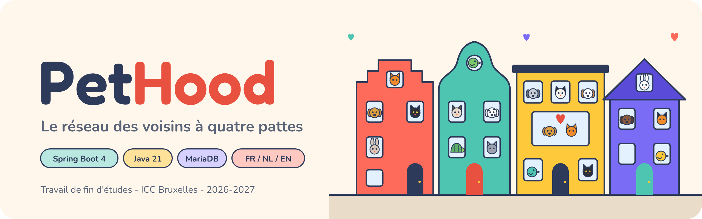
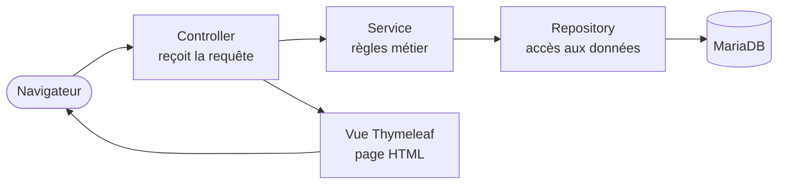

<p align="center">
  
</p>

<p align="center">
  
  
  
  
  
  
</p>

<p align="center">
  <b>Application web de garde d'animaux entre voisins, à Bruxelles.</b><br>
  Travail de fin d'études - Bachelier en informatique (développement d'applications) - ICC Bruxelles - 2026-2027
</p>

---

## Sommaire

- [À propos](#-à-propos)
- [Fonctionnalités](#-fonctionnalités)
- [Avancement](#-avancement)
- [Stack technique](#-stack-technique)
- [Architecture](#-architecture)
- [Base de données](#-base-de-données)
- [Lancer le projet](#-lancer-le-projet)
- [Structure du projet](#-structure-du-projet)
- [Conventions](#-conventions)
- [Auteur](#-auteur)

---

## 🏠 À propos

Partir en week-end, travailler tard ou être hospitalisé : trouver quelqu'un de confiance pour s'occuper de son animal n'est pas simple, et une pension coûte cher.

**PetHood** met en relation les propriétaires d'animaux d'un même quartier. Les voisins se rendent service **gratuitement** : promenade du chien, garde, visites à domicile ou surveillance de la maison. La confiance se construit grâce aux profils, aux fiches des animaux et aux évaluations après chaque service.

PetHood vit grâce à un **abonnement** (pour contacter les voisins et demander un service) et à une **commission** sur les produits neufs vendus par des partenaires dans la boutique.

### Les acteurs

| Acteur | Ce qu'il peut faire |
|---|---|
| 👀 **Visiteur** | Découvrir les voisins proches (profils floutés), parcourir la boutique, s'inscrire |
| 🐾 **Membre** | Créer la fiche de ses animaux, rendre service comme petsitter, participer à la vie du quartier, vendre ou donner des objets |
| ⭐ **Abonné** | Voir les profils complets, contacter les voisins, demander un service |
| 🏪 **Partenaire commercial** | Vendre des produits neufs dans la boutique |
| 🛠️ **Administrateur** | Gérer la plateforme depuis le back-office |
| 📱 **Application cliente** | Utiliser l'API sécurisée au nom d'un membre |

---

## ✨ Fonctionnalités

### Les services entre voisins (toujours gratuits)

| Service | Description |
|---|---|
| 🦮 Promenade | Le petsitter promène le chien quelques heures |
| 🏡 Garde chez le petsitter | L'animal vit chez le petsitter pendant l'absence |
| 🛏️ Garde à domicile | Le petsitter dort chez le propriétaire |
| 🔑 Visites à domicile | Le petsitter passe une ou plusieurs fois par jour |
| 🪴 Gardiennage de maison | Plantes, courrier, volets, avec ou sans animal |

### Et aussi

- 📍 Recherche des voisins par distance, avec position protégée (distance arrondie, adresse jamais affichée)
- 🐶 Fiches des animaux : chiens, chats, lapins, oiseaux, rongeurs, reptiles, poissons, volailles et NAC
- ⭐ Évaluations croisées (petsitter, propriétaire et animal) et badge **« Patte d'or »**
- 📸 Mur photo du quartier, forum et promenades collectives
- 🛍️ Boutique : objets d'occasion entre membres et produits neufs des partenaires
- 💳 Paiement en ligne sécurisé (Stripe, mode test)
- 🌍 Site entièrement en **français, néerlandais et anglais**
- 🛠️ Back-office avec journal d'activité
- 🔐 API REST sécurisée (JWT)
- 🛡️ RGPD : téléchargement des données et suppression du compte

> Le cahier de charges fonctionnel complet décrit 91 exigences, classées par acteur et par importance.

---

## 📈 Avancement

| Étape | Contenu | Statut |
|---|---|---|
| 1. Démarrage | Projet Spring Boot, connexion à la base, Flyway, premier contrôleur | ✅ Terminé |
| 2. Données (CRUD) | Espèces : table, entité, repository, service, pages | 🔄 En cours |
| 3. Relations simples | Races, codes postaux, messages de notification | ⏳ À venir |
| 4. Sécurité | Inscription, connexion, rôles, profil | ⏳ À venir |
| 5. Relations complexes | Animaux, services proposés, demandes de service | ⏳ À venir |
| 6. Communauté | Évaluations, badge, mur, forum, promenades | ⏳ À venir |
| 7. Abonnement et boutique | Stripe, annonces, produits des partenaires | ⏳ À venir |
| 8. API | API REST sécurisée par JWT | ⏳ À venir |
| 9. Finitions | Multilinguisme, back-office, tests, mise en ligne | ⏳ À venir |

---

## 🧰 Stack technique

| Couche | Technologie |
|---|---|
| Langage | Java 21 |
| Framework | Spring Boot 4.1.2 (Spring Web, Spring Data JPA, Validation, DevTools) |
| Vues | Thymeleaf |
| Base de données | MariaDB 10.4 (XAMPP en local) |
| Migrations | Flyway |
| Build | Maven (wrapper inclus) |
| IDE | IntelliJ IDEA |
| Versioning | Git et GitHub |

---

## 🏗️ Architecture

L'application est organisée en couches. Chaque couche ne parle qu'à la couche voisine.



---

## 🗄️ Base de données

La base est **entièrement créée par le code** :

- la base vide `pethood` est créée au démarrage (`createDatabaseIfNotExist=true`) ;
- les tables et les données de départ sont créées par les scripts **Flyway**, dans l'ordre ;
- Hibernate ne modifie jamais les tables (`ddl-auto=none`).

| Script | Rôle |
|---|---|
| `V1__create_species_table.sql` | Table des espèces (noms en FR, NL et EN) |
| `V2__insert_species.sql` | Chien, chat, lapin, oiseau, rongeur |
| `V3__insert_other_species.sql` | Reptile, poisson, volaille, autre (NAC) |

---

## 🚀 Lancer le projet

### Prérequis

- Java 21
- XAMPP (MariaDB démarré sur le port 3306, utilisateur `root` sans mot de passe)

### Étapes

```bash
git clone https://github.com/cesarramosict/pethood.git
cd pethood
./mvnw spring-boot:run
```

Sous Windows : `mvnw.cmd spring-boot:run`.

Ouvrir ensuite [http://localhost:8080](http://localhost:8080).

---

## 📁 Structure du projet

```
src/main/java/be/pethood
├── PethoodApplication.java     point d'entrée
├── HomeController.java         page d'accueil
├── model/                      entités JPA (Species...)
├── repository/                 accès aux données
└── service/                    règles métier

src/main/resources
├── application.properties      configuration
└── db/migration/               scripts Flyway (V1, V2, V3...)
```

---

## 📝 Conventions

- Messages de commit en **anglais**.
- Commentaires du code et Javadoc en **français**.
- Un script Flyway déjà exécuté n'est jamais modifié : chaque changement crée un nouveau script.
- Petits commits réguliers : le projet avance pas à pas.

---

## 👤 Auteur

**Julio César Ramos do Carmo**
Étudiant en dernière année - ICC Bruxelles (Institut des Carrières Commerciales)
GitHub : [cesarramosict](https://github.com/cesarramosict)

---

<sub>Ce README et sa bannière ont été réalisés avec l'aide d'un assistant IA (Claude, Anthropic), puis relus par l'auteur, conformément à la Charte IA de l'ICC.</sub>
